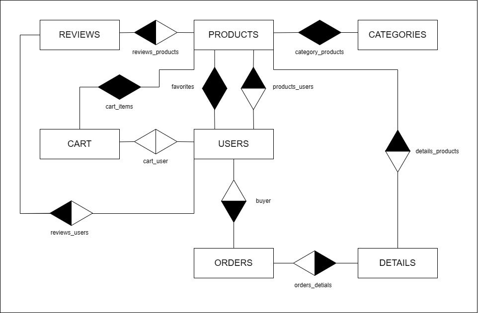

# Diseño de la Base de Datos - NEXUS

## Índice
- [Diseño de la Base de Datos - NEXUS](#diseño-de-la-base-de-datos---nexus)
  - [Índice](#índice)
  - [1. Diagrama Entidad-Relación (E-R)](#1-diagrama-entidad-relación-e-r)
  - [2. Diccionario de Datos](#2-diccionario-de-datos)
    - [2.1. Usuarios (Compradores y Vendedores)](#21-usuarios-compradores-y-vendedores)
      - [**TABLE: USERS**](#table-users)
    - [2.2. Catálogo de Productos](#22-catálogo-de-productos)
      - [**TABLE: CATEGORIES**](#table-categories)
      - [**TABLE: PRODUCTS**](#table-products)
      - [**TABLE: CATEGORY\_PRODUCT**](#table-category_product)
    - [2.3. Carrito de Compra (Persistencia)](#23-carrito-de-compra-persistencia)
      - [**TABLE: CARTS**](#table-carts)
      - [**TABLE: CART\_ITEMS**](#table-cart_items)
    - [2.4. Pedidos y Facturación](#24-pedidos-y-facturación)
      - [**TABLE: ORDERS**](#table-orders)
      - [**TABLE: DETAILS**](#table-details)
    - [2.5. Social y Valoraciones](#25-social-y-valoraciones)
      - [**TABLE: REVIEWS**](#table-reviews)
      - [**TABLE: FAVORITES**](#table-favorites)
  - [3. Anexo: Script SQL](#3-anexo-script-sql)

---

## 1. Diagrama Entidad-Relación (E-R)

Aquí mostramos el diseño final de la base de datos. Lo hemos planteado para que soporte un modelo P2P donde cualquier usuario puede vender y comprar. Además, un producto puede pertenecer a varias categorías gracias a la tabla pivote.

<p align="center">
    
</p>

---

## 2. Diccionario de Datos

A continuación explicamos cada tabla y por qué la hemos diseñado así.

### 2.1. Usuarios (Compradores y Vendedores)

#### **TABLE: USERS**
> Hemos unificado todo en una sola tabla. Al ser un marketplace de usuario a usuario, no tenía sentido separar tablas o roles complejos. Con una sola cuenta puedes publicar tus productos o comprar los de otros.

| Campo | Tipo de Dato | Propiedades | Descripción |
| :--- | :--- | :--- | :--- |
| **id_user** | `INT` | **PK**, Auto Inc | ID único del usuario. |
| `username` | `VARCHAR(50)` | Unique, Not Null | El nombre que se verá en la web. |
| `email` | `VARCHAR(255)` | Unique, Not Null | Para el login y correos. |
| `password` | `VARCHAR(255)` | Not Null | La contraseña va hasheada (por seguridad). |
| `avatar` | `VARCHAR(255)` | Nullable | URL de la foto de perfil. |
| `created_at` | `DATETIME` | Default Current | Cuándo se registró. |

---

### 2.2. Catálogo de Productos

#### **TABLE: CATEGORIES**
> Tabla sencilla para organizar los archivos (ej: Iconos, UI Kits, 3D...).

| Campo | Tipo de Dato | Propiedades | Descripción |
| :--- | :--- | :--- | :--- |
| **id_category** | `INT` | **PK**, Auto Inc | ID de la categoría. |
| `name` | `VARCHAR(50)` | Not Null | El nombre de la sección. |

#### **TABLE: PRODUCTS**
> Aquí está el core del proyecto. Separamos la imagen de muestra (`image_url`) del archivo real (`file_url`) para que nadie se descargue el producto sin pagar.

| Campo | Tipo de Dato | Propiedades | Descripción |
| :--- | :--- | :--- | :--- |
| **id_product** | `INT` | **PK**, Auto Inc | ID del producto. |
| `title` | `VARCHAR(100)` | Not Null | Título del archivo en venta. |
| `description` | `TEXT` | Nullable | Explicación de qué incluye la descarga. |
| `price` | `DECIMAL(10,2)` | Not Null | Precio. Usamos decimal para evitar líos con céntimos. |
| `file_url` | `VARCHAR(255)` | Not Null | La ruta privada del zip/rar. |
| `image_url` | `VARCHAR(255)` | Nullable | La imagen que se ve en la tienda. |
| `active` | `BOOLEAN` | Default True | `1` visible, `0` oculto (borrado lógico). |
| `user_id` | `INT` | **FK** | Quién lo vende. |
| `created_at` | `DATETIME` | Default Current | Fecha de subida. |

#### **TABLE: CATEGORY_PRODUCT**
> Tabla pivote. Nos dimos cuenta de que un producto puede encajar en varias categorías a la vez (ej: "Terror" y "Audio"), así que usamos esta relación N:M.

| Campo | Tipo de Dato | Propiedades | Descripción |
| :--- | :--- | :--- | :--- |
| **category_id** | `INT` | **PK Compuesta** | ID de la categoría. |
| **product_id** | `INT` | **PK Compuesta** | ID del producto. |

---

### 2.3. Carrito de Compra (Persistencia)

#### **TABLE: CARTS**
> Decidimos crear estas tablas para que el carrito no se pierda si el usuario cierra el navegador. Si usáramos solo LocalStorage, perderían su selección al cambiar de dispositivo.

| Campo | Tipo de Dato | Propiedades | Descripción |
| :--- | :--- | :--- | :--- |
| **id_cart** | `INT` | **PK**, Auto Inc | ID del carrito. |
| `user_id` | `INT` | **FK** | De quién es este carrito. |
| `updated_at` | `DATETIME` | On Update | Para saber cuándo fue lo último que tocó. |

#### **TABLE: CART_ITEMS**
> Aquí guardamos temporalmente qué productos ha metido en el carro antes de pagar.

| Campo | Tipo de Dato | Propiedades | Descripción |
| :--- | :--- | :--- | :--- |
| **id_cart_item** | `INT` | **PK**, Auto Inc | ID de la línea. |
| `cart_id` | `INT` | **FK** | Relación con la tabla `carts`. |
| `product_id` | `INT` | **FK** | Qué producto quiere comprar. |
| `added_at` | `DATETIME` | Default Current | Cuándo lo añadió. |

---

### 2.4. Pedidos y Facturación

#### **TABLE: ORDERS**
> La cabecera del pedido. Se crea en el momento exacto en que el pago se confirma.

| Campo | Tipo de Dato | Propiedades | Descripción |
| :--- | :--- | :--- | :--- |
| **id_order** | `INT` | **PK**, Auto Inc | ID de la transacción. |
| `total` | `DECIMAL(10,2)` | Not Null | Lo que pagó en total. |
| `status` | `ENUM` | Default 'pending' | Control de estados (`pending`, `completed`...). |
| `user_id` | `INT` | **FK** | Quién ha pagado. |
| `created_at` | `DATETIME` | Default Current | Fecha de la compra. |

#### **TABLE: DETAILS**
> **Importante:** Esta tabla guarda el histórico. Copiamos aquí el precio del producto en el momento de la compra. Así, si el vendedor cambia el precio mañana, el registro de lo que pagó el usuario no cambia.

| Campo | Tipo de Dato | Propiedades | Descripción |
| :--- | :--- | :--- | :--- |
| **id_detail** | `INT` | **PK**, Auto Inc | ID de la línea de pedido. |
| `id_order` | `INT` | **FK** | A qué pedido pertenece. |
| `id_product` | `INT` | **FK** | Qué se compró. |
| `price` | `DECIMAL(10,2)` | Not Null | Precio congelado al momento de compra. |

---

### 2.5. Social y Valoraciones

#### **TABLE: REVIEWS**
> Sistema para dar feedback y confianza. Relaciona usuarios y productos.

| Campo | Tipo de Dato | Propiedades | Descripción |
| :--- | :--- | :--- | :--- |
| **id_review** | `INT` | **PK**, Auto Inc | ID de la review. |
| `rating` | `TINYINT` | Not Null | Nota del 1 al 5. |
| `comment` | `TEXT` | Nullable | El texto de la opinión. |
| `user_id` | `INT` | **FK** | Quién opina. |
| `product_id` | `INT` | **FK** | Qué producto valora. |

#### **TABLE: FAVORITES**
> La típica "Wishlist". Es una relación N:M directa.

| Campo | Tipo de Dato | Propiedades | Descripción |
| :--- | :--- | :--- | :--- |
| **user_id** | `INT` | **PK Compuesta** | Usuario que da like. |
| **product_id** | `INT` | **PK Compuesta** | Producto que guarda. |
| `created_at` | `DATETIME` | Default Current | Fecha del like. |

---

## 3. Anexo: Script SQL

```sql
CREATE DATABASE IF NOT EXISTS nexus_db;
USE nexus_db;

-- 1. Usuarios
CREATE TABLE users (
    id_user INT AUTO_INCREMENT PRIMARY KEY,
    username VARCHAR(50) NOT NULL UNIQUE,
    email VARCHAR(255) NOT NULL UNIQUE,
    password VARCHAR(255) NOT NULL,
    avatar VARCHAR(255),
    created_at DATETIME DEFAULT CURRENT_TIMESTAMP
);

-- 2. Categorías
CREATE TABLE categories (
    id_category INT AUTO_INCREMENT PRIMARY KEY,
    name VARCHAR(50) NOT NULL
);

-- 3. Productos (Sin category_id, ahora va por tabla pivote)
CREATE TABLE products (
    id_product INT AUTO_INCREMENT PRIMARY KEY,
    title VARCHAR(100) NOT NULL,
    description TEXT,
    price DECIMAL(10, 2) NOT NULL,
    file_url VARCHAR(255) NOT NULL,
    image_url VARCHAR(255),
    active BOOLEAN DEFAULT TRUE,
    user_id INT,
    created_at DATETIME DEFAULT CURRENT_TIMESTAMP,
    FOREIGN KEY (user_id) REFERENCES users(id_user)
);

-- 3.1 Tabla Pivote Categoría-Producto
CREATE TABLE category_product (
    category_id INT,
    product_id INT,
    PRIMARY KEY (category_id, product_id),
    FOREIGN KEY (category_id) REFERENCES categories(id_category) ON DELETE CASCADE,
    FOREIGN KEY (product_id) REFERENCES products(id_product) ON DELETE CASCADE
);

-- 4. Carritos
CREATE TABLE carts (
    id_cart INT AUTO_INCREMENT PRIMARY KEY,
    user_id INT,
    updated_at DATETIME DEFAULT CURRENT_TIMESTAMP ON UPDATE CURRENT_TIMESTAMP,
    FOREIGN KEY (user_id) REFERENCES users(id_user)
);

-- 5. Items del Carrito
CREATE TABLE cart_items (
    id_cart_item INT AUTO_INCREMENT PRIMARY KEY,
    cart_id INT,
    product_id INT,
    added_at DATETIME DEFAULT CURRENT_TIMESTAMP,
    FOREIGN KEY (cart_id) REFERENCES carts(id_cart) ON DELETE CASCADE,
    FOREIGN KEY (product_id) REFERENCES products(id_product) ON DELETE CASCADE
);

-- 6. Pedidos
CREATE TABLE orders (
    id_order INT AUTO_INCREMENT PRIMARY KEY,
    total DECIMAL(10, 2) NOT NULL,
    status ENUM('pending', 'completed', 'cancelled') DEFAULT 'pending',
    user_id INT,
    created_at DATETIME DEFAULT CURRENT_TIMESTAMP,
    FOREIGN KEY (user_id) REFERENCES users(id_user)
);

-- 7. Detalles del Pedido
CREATE TABLE details (
    id_detail INT AUTO_INCREMENT PRIMARY KEY,
    id_order INT,
    id_product INT,
    price DECIMAL(10, 2) NOT NULL,
    FOREIGN KEY (id_order) REFERENCES orders(id_order) ON DELETE CASCADE,
    FOREIGN KEY (id_product) REFERENCES products(id_product)
);

-- 8. Reseñas
CREATE TABLE reviews (
    id_review INT AUTO_INCREMENT PRIMARY KEY,
    rating TINYINT NOT NULL,
    comment TEXT,
    user_id INT,
    product_id INT,
    created_at DATETIME DEFAULT CURRENT_TIMESTAMP,
    FOREIGN KEY (user_id) REFERENCES users(id_user),
    FOREIGN KEY (product_id) REFERENCES products(id_product)
);

-- 9. Favoritos
CREATE TABLE favorites (
    user_id INT,
    product_id INT,
    created_at DATETIME DEFAULT CURRENT_TIMESTAMP,
    PRIMARY KEY (user_id, product_id),
    FOREIGN KEY (user_id) REFERENCES users(id_user) ON DELETE CASCADE,
    FOREIGN KEY (product_id) REFERENCES products(id_product) ON DELETE CASCADE
);