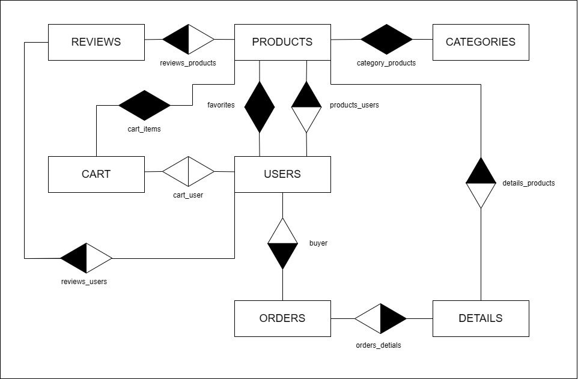

# Índice
- [1. Introducción y Objetivos](#1-introducción-y-objetivos)
    - [1.1 Motivación](#11-motivación)
    - [1.2 Objetivos](#12-objetivos)
- [2. Análisis de Requisitos](#2-análisis-de-requisitos)
    - [2.1 Requisitos Funcionales](#21-requisitos-funcionales)
    - [2.2 Requisitos No Funcionales](#22-requisitos-no-funcionales)
- [3. Stack Tecnológico y Herramientas](#3-stack-tecnólogico-y-herramientas)
    - [3.1 Frontend](#31-frontend)  
    - [3.2 Backend](#32-backend)
    - [3.3 Base de Datos](#33-base-de-datos)  
    - [3.4 Integraciones y Servicios de Terceros](#34-integraciones-y-servicios-de-terceros)
    - [3.5 Herramientas de Desarrollo y Diseño](#35-herramientas-de-desarrollo-y-diseño)
- [4. Arquitectura y Diseño](#4-arquitectura-y-diseño)
    - [4.1 Arquitectura del Sistema](#41-arquitectura-del-sistema)
    - [4.2 Modelo de Datos - Diagrama Entidad-Relación](#42-modelo-de-datos-diagrama-entidad-relación)
    - [4.3 Diseño Interfaz (UI/UX)](#43-diseño-de-interfaz-uiux)

# 1. Introducción y Objetivos

## 1.1 Motivación

El proyecto **Nexus** nace como respuesta a la creciente demanda de recursos digitales (iconos, plantillas, librerías de programación, etc.) por parte de creadores y desarrolladores. Actualmente, gran parte del mercado obliga al usuario a atarse a modelos de suscripción mensual para acceder a este tipo de contenido. La motivación principal de Nexus es ofrecer una alternativa más flexible y justa, democratizando el acceso a estos recursos mediante una plataforma de compra directa (o un modelo mixto), mejorando así la experiencia y la rentabilidad tanto para los creadores como para los consumidores.

## 1.2 Objetivos

- Objetivo General:
    - Diseñar y desarrollar un e-commerce tipo Marketplace completo y funcional para la distribución de contenido digital.
- Objetivos Específicos:
    - Implementar un sistema de registro, autenticación y gestión de roles.
    - Integrar una pasarela de pago segura para procesar las transacciones de los productos.
    - Desarrollar paneles de control (dashboards) intuitivos para la gestión del catálogo y la administración de la plataforma.
    - Crear un módulo eficiente para la gestión de incidencias y soporte al usuario.
    - Desarrollar un sistema de gestión de planes de suscripción y control de acceso al contenido.
    - Implementar verificación por correo electrónico.

# 2. Análisis de Requisitos

En esta sección se detallan las funcionalidades que debe cumplir la plataforma **Nexus**, así como las restricciones y características técnicas necesarias para garantizar un correcto funcionamiento y una buena experiencia de usuario.

## 2.1 Requisitos Funcionales

Los requisitos funcionales se han dividido en función de los diferentes roles de usuario que interactúan con el sistema.

### 2.1.1 Usuario No Registrado

- **RF-01**: El usuario podrá visualizar la página inicial y ver nuestros términos y condiciones.
- **RF-02**: El usuario podrá acceder al formulario de registro para crear una cuenta nueva.

### 2.1.2 Usuario Registrado

- **RF-03**: El sistema exigirá la verificación por correo electrónico tras el registro para activar la cuenta.
- **RF-04**: El usuario podrá añadir productos a un carrito de la compra y proceder al pago.
- **RF-05**: El usuario podrá suscribirse a un plan mensual o anual mediante la pasarela de pago para acceder a contenido premium.
- **RF-06**: El usuario tendrá acceso a una biblioteca personal o historial de compras donde podrá descargar los recursos adquiridos.
- **RF-07**: El usuario podrá abrir tickets de soporte o reportar incidencias relacionadas con los productos o la plataforma.
- **RF-08**: El usuario podrá ver los productos en tendencia, los destacados, así como explorarlos todo.
- **RF-09**: El usuario podrá añadir productos a favoritos.
- **RF-10**: El usuario podrá cambiar su contraseña y editar su perfil.

### 2.1.3 Administrador

- **RF-11**: El administrador tendrá acceso a un panel de control exclusivo.
- **RF-12**: El administrador podrá gestionar los roles de los usuarios así como bloquear cuentas.
- **RF-13**: El administrador podrá gestionar los productos digitales del catálogo.
- **RF-14**: El administrador podrá visualizar las estadísticas de ventas, suscripciones activas y métricas de la plataforma.
- **RF-15**: El administrador podrá gestionar los reembolsos.
- **RF-16**: El administrador podrá ver los logs de la aplicación.

## 2.2 Requisitos No Funcionales

- **RNF-01**: Las contraseñas de los usuarios deben almacenarse de forma encriptada en la base de datos.
- **RNF-02**: Las transacciones económicas se realizarán a través de una pasarela de pago segura, sin almacenar datos bancarios sensibles en los servidores propios.
- **RNF-03**: La interfaz de usuario debe adaptarse correctamente a dispositivos móviles, tablets y ordenadores de escritorio.
- **RNF-04**: El tiempo de carga de las páginas principales y del catálogo no debe superar los 3 segundos en condiciones de red óptimas.
- **RNF-05**: El sistema debe estar preparado para estar operativo 24/7 y gestionar la concurrencia de múltiples usuarios navegando y descargando recursos simultáneamente.

# 3. Stack Tecnólogico y Herramientas

En este capítulo se detallan las tecnologías, lenguajes de programación y herramientas de software que se han seleccionado para el desarrollo y despliegue de la plataforma Nexus, justificando la elección de cada una de ellas para garantizar un sistema escalable y robusto.

## 3.1 Frontend

- **HTML5**: Utilizado como lenguaje de marcado base para definir la estructura semántica de todas las vistas de la plataforma.
- **SCSS**: Empleado como preprocesador de CSS para estilizar la aplicación. Su uso ha permitido mantener un código de estilos modular y escalable mediante variables y anidamiento, facilitando un diseño coherente en todo el marketplace.
- **Vue.js**: Seleccionado como framework principal de JavaScript para construir la interfaz de usuario. Se ha elegido por su reactividad y su arquitectura basada en componentes, lo que permite crear una experiencia dinámica, rápida e interactiva para el usuario final.

## 3.2 Backend

- **Laravel (PHP)**: Seleccionado como framework de backend por su robustez y su arquitectura basada en el patrón MVC (Modelo-Vista-Controlador). Se ha utilizado para desarrollar de forma limpia y segura toa la lógica de negocio, la gestión de rutas, la autenticación de usuarios y la comunicación fluida con la base de datos.

## 3.3 Base de Datos

- **SQL (Base de Datos Relacional)**: Se ha optado por un sistema de gestión de bases de datos relacional para garantizar la integridad y coherencia de la información. Su uso permite relacionar de forma estructurada y eficiente los datos de las cuentas de usuario, el catálogo de productos digitales, los roles y el historial de compras.

## 3.4 Integraciones y Servicios de Terceros

- **Pasarela de Pago (PayPal)**: Integrada para procesar las transacciones económicas de la plataforma. Se ha elegido por su fiabilidad y facilidad de uso, permitiendo gestionar los pagos de compra directa de forma segura, garantizando que no se almacenen datos bancarios sensibles en los servidores de Nexus.

## 3.5 Herramientas de Desarrollo y Diseño

- **Visual Studio Code**: Editor de código fuente principal utilizado para el desarrollo tanto del frontend como del backend, apoyado por extensiones específicas para Vue.js y Laravel que han optimizado el flujo de trabajo.
- **Git y GitHub**: Sistema de control de versiones utilizado para gestionar el código de forma segura, permitiendo mantener un historial de cambios y facilitar el despliegue del proyecto.
- **Figma**: Herramienta de diseño de interfaces (UI) y experiencia de usuario (UX) empleada para crear los prototipos visuales y el diseño artístico de Nexus antes de su implementación.
- **Draw.io**: Utilizada específicamente para el modelo de la base de datos, permitiendo diseñar los diagramas entidad-relación necesarios para estructurar la información en SQL de forma lógica y visual.

# 4 Arquitectura y Diseño

En este apartado se describe la estructura interna de la plataforma Nexus, detallando cómo se organizan los componentes del software y cómo se ha diseñado la persistencia de los datos y la interfaz de usuario.

## 4.1 Arquitectura del Sistema

Para el desarrollo de Nexus se ha optado por una arquitectura de aplicaciones web modernas basada en la separación del Frontend y el Backend.

- **Backend (API REST)**: Laravel funciona como el motor central del sistema. Utiliza el patrón MVC (Modelo-Vista-Controlador) para gestionar la lógica de negocio y exponer una API REST. Esta API es la encargada de procesar las peticiones, gestionar la seguridad y servir los datos necesarios en formato JSON.
- **Frontend (SPA)**: La interfaz de usuario, desarrollada con Vue.js, funciona como una Single Page Application (SPA). Esto significa que la aplicación se carga una sola vez y se comunica de forma asíncrona con el backend de Laravel, lo que proporciona una navegación fluida y rápida, similar a una aplicación de escritorio.

## 4.2 Modelo de Datos (Diagrama Entidad-Relación)

El diseño de la base de datos se ha realizado mediante un modelo relacional utilizando la herramienta draw.io. El objetivo ha sido normalizar la información para evitar redundancias y asegurar la integridad de los datos.

Las entidad principales definidas en el sistema son:
- **Users**: Almacena la información de perfiles, credenciales encriptadas y roles.
- **Products**: Contiene los detalles de los recursos digitales, precios y archivos.
- **Orders**: Registra las compras realizadas y el estado de los pagos procesados a través de PayPal.
- **Categories**: Registra todas las categorías que pueden tener los productos.
- **Reviews**: Para que cada producto tenga su propia valoración.

    

## 4.3 Diseño de Interfaz (UI/UX)

El diseño visual de Nexus se ha centrado en la usabilidad y limpieza, buscando que el usuario encuentre el contenido digital de forma intuitiva.

- **Prototipo de Figma**: Antes de comenzar la fase de programación, se crearon wireframes y prototipos de alta fidelidad en Figma. Esto permitió definir la paleta de colores, la tipografía y la disposición de los elementos (como el carrito de compra y el panel de administrador) de forma previa.
- **Diseño Responsive**: Gracias al uso de SCSS y las capacidades visuales de Vue, la interfaz se ha diseñado para ser totalmente adaptable. El marketplace es perfectamente funcional tanto en navegadores de escritorio como en dispositivos móviles, ajustando sus menús y rejillas de productos automáticamente.